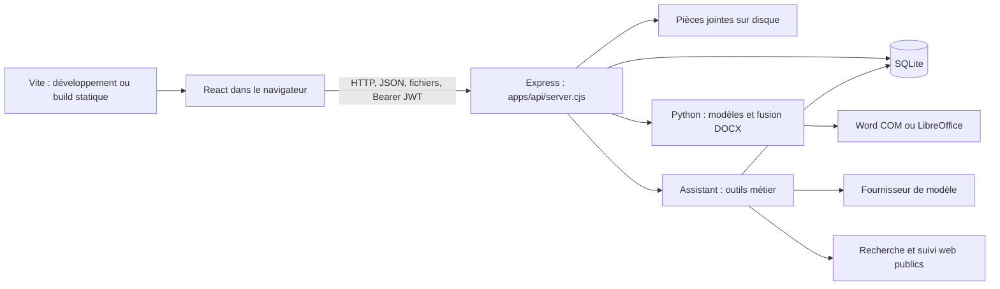

# Tradivia — documentation technique du site

Cette documentation décrit **le code présent dans ce projet** et les parcours réellement câblés : interface React, API Express, stockage SQLite, pièces jointes, exports Word/PDF et assistant IA. Les rapports LaTeX/PDF, captures et diagrammes de présentation ne font pas partie du site. Les doubles historiques du **code** sont inventoriés, car ils peuvent être confondus avec les sources d'exécution.

## Sommaire

| Chapitre | Contenu |
| --- | --- |
| [01 — Cartographie fichier par fichier](docs/technique/01-cartographie.md) | Sources actives, fichiers historiques, dossiers, dépendances, artefacts et responsabilités |
| [02 — Interface et fonctionnalités](docs/technique/02-interface-et-metier.md) | Composants React, interactions, formulaires, filtres, calculs métier et écrans |
| [03 — API et données](docs/technique/03-api-et-donnees.md) | Démarrage serveur, routes, paramètres, retours, tables, relations, validation et migrations |
| [04 — Pièces jointes et exports](docs/technique/04-documents.md) | Stockage des fichiers, quatre modèles Word, Python, fusion, PDF et différences entre parcours d'export |
| [05 — Assistant IA](docs/technique/05-assistant-ia.md) | Interfaces de chat, conversations, fournisseur, outils, confirmation, journalisation et suivi public |
| [06 — Installation, tests et maintenance](docs/technique/06-exploitation.md) | Configuration, commandes, vérifications effectuées, sauvegarde, dépannage et limites observées |

## En une vue

### Points d'entrée réellement utilisés

| Partie | Chemin d'exécution |
| --- | --- |
| Web | `apps/web/index.html` → `apps/web/src/main.jsx` → `apps/web/src/app/App.jsx` (réexport) → **`App.jsx` à la racine** (interface complète). |
| API | `npm run dev:api` ou `npm run start -w @tradivia/api` → **`apps/api/server.cjs`**. |
| Base principale | `apps/api/tradivia.db` par défaut ; configurable par `DATABASE_PATH`. |
| Assistant | `server.cjs` charge `apps/api/agent/agent.cjs`, qui utilise `apps/api/agent/web.cjs`. |
| Documents | L'API lance les scripts de **`workers/documents/`**, qui utilisent les modèles de son sous-dossier `templates/`. |

### Exemple de parcours de bout en bout

1. L'utilisateur ouvre l'écran Factures et sélectionne un client existant. React calcule un aperçu en fonction de la quantité ou d'un total TTC imposé.
2. React envoie `POST /api/factures` avec le JWT. Express vérifie la session, valide le client et la date, recalcule les montants et enregistre la facture dans SQLite.
3. L'interface reçoit la ligne créée, l'ajoute à sa liste et recalcule les indicateurs visibles. Une demande d'export déclenche ensuite une opération distincte.
4. L'API lance Python pour remplir le modèle Word. Pour le PDF, Python appelle le convertisseur installé sur la machine. Le navigateur reçoit le binaire et déclenche le téléchargement.

## Où modifier quoi ?

| Besoin | Premier fichier à ouvrir |
| --- | --- |
| Modifier une page, un formulaire, le thème ou la navigation | [`App.jsx`](App.jsx), à la racine |
| Modifier une validation, une règle métier HTTP ou un calcul fiscal | [`apps/api/server.cjs`](apps/api/server.cjs) |
| Modifier un outil de l'assistant ou son protocole de confirmation | [`apps/api/agent/agent.cjs`](apps/api/agent/agent.cjs) |
| Modifier la recherche, la lecture de pages ou le suivi transporteur | [`apps/api/agent/web.cjs`](apps/api/agent/web.cjs) |
| Modifier une mise en page de facture ou de virement | `workers/documents/templates/`, puis contrôler les variables d'export dans l'API et, pour l'export unitaire de l'écran Factures, dans `App.jsx` |
| Modifier le remplissage Word, la fusion ou la conversion PDF | [`workers/documents/fill_template.py`](workers/documents/fill_template.py) et [`workers/documents/merge_invoices.py`](workers/documents/merge_invoices.py) |
| Modifier les URL, ports ou chemins de stockage | [`.env.example`](.env.example), `.env` local, [`apps/web/vite.config.js`](apps/web/vite.config.js) |

## Constats importants pour la maintenance

- **Ne pas confondre les deux `App.jsx`.** L'ancienne documentation présente celui de la racine comme une archive ; il est aujourd'hui importé par l'application web.
- **La clôture comptable enregistre un état récapitulatif.** Elle ne verrouille pas les écritures de l'année et peut être recalculée par l'API.
- **Les ordres de virement sont des documents.** Le site n'effectue pas de transaction bancaire. Le champ Banque du formulaire bénéficiaire n'est actuellement ni stocké ni exporté par l'API.
- **La société modifiable et les modèles sont deux sources distinctes.** Modifier la fiche Société ne réécrit pas les mentions déjà intégrées aux fichiers Word.
- **L'authentification du navigateur tente actuellement un accès avec le compte initial quand aucune session n'est présente.** Changer le mot de passe initial ; supprimer ce mécanisme du frontend avant toute publication. Détails dans le [chapitre d'exploitation](docs/technique/06-exploitation.md).

**Vérifications effectuées :** build de production du frontend, 13 tests Node réussis avec les scénarios DOCX de l'intégration activés, et 4 tests Python réussis. La conversion en PDF avec Word/LibreOffice et les appels à un fournisseur IA ou à un transporteur réels n'ont pas été vérifiés pendant cette analyse.
