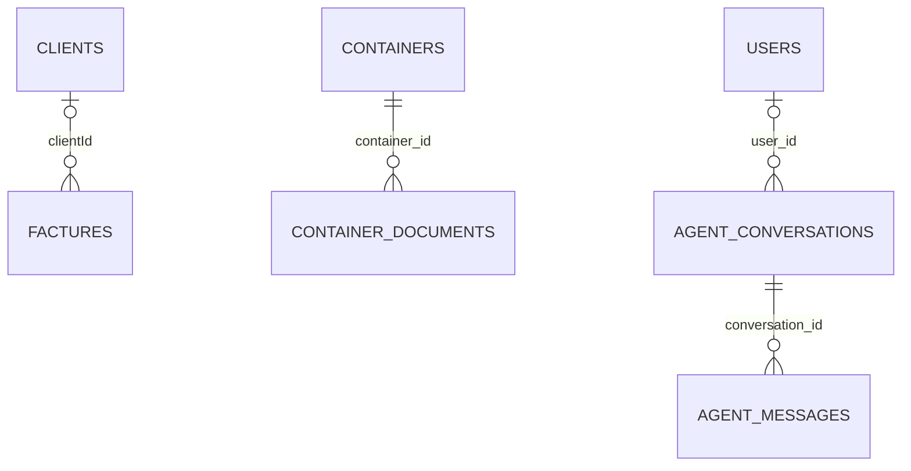

# 03 — API Express et modèle de données SQLite

[Retour au sommaire](../../DOCUMENTATION_TECHNIQUE.md) · [Règles métier et écrans](02-interface-et-metier.md)

## Organisation de `server.cjs`

Les lignes sont indicatives et servent à naviguer dans la version analysée. [`server.cjs`](../../apps/api/server.cjs) est le serveur actif ; il n'importe pas les anciens routeurs sous `src/modules/`.

| Bloc | Détail |
| --- | --- |
| Début, lignes 1–96 | Imports, `dotenv`, configuration JWT, CORS, parseur JSON (1 Mio), dossiers de pièces jointes, `safe`, validation d'identifiants, année et trimestre. |
| 98–217 | `computeFactureAmounts` et `round2` pour les montants ; `frNumberSrv`, `fmtDateSrv`, `numToWords`, `moneyToWords`, `buildInvoiceVarsSrv` pour les modèles Word. |
| 219–449 | Ouverture SQLite, DDL `CREATE TABLE IF NOT EXISTS`, `ensureColumn`, migration des personnes, index CIN, exemples optionnels et premier compte. |
| 451–600 | `signToken`, `requireAuth`, `requireRole`, login, santé, Société, comptes et rapport d'anomalies. |
| 602–987 | Clients, factures, suppression groupée, conteneurs, métadonnées de documents, ajout/aperçu/téléchargement/suppression et configuration Multer. |
| 989–1472 | Charges et statistiques, ordres TVA/bénéficiaire et leurs exports, agrégats comptables et clôture. |
| 1474–1727 | Résolution des modèles/du Python, `median`, `normalizeIdentity`, `isValidIban`, `buildAnomalyReport`, `runPython`, `runFill`, variables TVA et estimation fiscale. |
| 1729–1907 | `handleRouteError`, `sendDocumentError`, nettoyage de nom, date ISO et nombre ; exports unitaires, par identifiant et groupé. |
| 1909–fin | Montage de l'assistant avec l'instance Express/SQLite et des helpers métier ; route 404, middleware d'erreurs, démarrage et arrêt ; exports CommonJS pour les tests. |

### Démarrage et durée de vie

`dotenv` lit `.env` à la racine ; les variables de processus déjà définies gardent la priorité. Le serveur prépare les dossiers, ouvre la base et initialise le schéma avant d'écouter le port (`3001` par défaut). `better-sqlite3` active `foreign_keys`, `journal_mode = WAL` et `busy_timeout = 5000`. La création de comptes/dossiers/tables a lieu **aussi quand le module est importé** ; seul `app.listen()` et les gestionnaires de signaux sont conditionnés par `require.main === module`. Les tests configurent donc une base temporaire avant l'import.

Le serveur déclare la connexion publique et la santé avant le middleware `app.use('/api', requireAuth)`. Les routes métier, les exports et l'assistant sont protégés, puis une route générique renvoie `404` aux chemins inconnus accessibles. CORS autorise les origines configurées ainsi que les requêtes sans `Origin` ; CORS n'est pas un contrôle de connexion. Lors d'un arrêt normal par signal, le serveur ferme les connexions HTTP puis SQLite, avec un délai de repli. Une erreur `EADDRINUSE` est signalée en console comme instance déjà en cours.

### Authentification, validation et erreurs

- Login : nom d'utilisateur passé à `trim()`, lecture d'un compte actif, comparaison bcrypt, mise à jour de `last_login`, retour `{token, user}`. Le coût bcrypt utilisé lors des créations/changements est `10`.
- Le JWT expire après `8h`. Il transporte `id`, `username`, `role` et un marqueur lié au hachage. À chaque requête, le serveur vérifie le JWT, relit le compte et refuse une session si le compte est désactivé ou si le marqueur a changé après changement de mot de passe. `req.user` ne contient pas le hachage.
- `requireRole('admin')` protège la mise à jour Société et les routes de gestion des utilisateurs. Le rôle standard peut accéder aux routes métier, y compris les suppressions et la clôture. Il n'y a pas de cloisonnement métier par propriétaire ; les conversations, elles, sont filtrées par compte.
- `isValidId` accepte un entier positif sous forme de chiffres ; `isIsoDate` valide le format `AAAA-MM-JJ` **et** la date réelle par conversion UTC. `numberInRange` convertit avec `Number`, vérifie valeur finie et borne, puis arrondit à deux décimales. Certains champs ont un contrôle « obligatoire » avant conversion ; ne pas supposer que toute chaîne vide ou valeur absente est uniformément traitée de la même manière. Année comptable : année actuelle si absente, sinon `2000…2100` en quatre chiffres. Le trimestre converti doit valoir 1 à 4.
- `safe` capture les exceptions et rejets de promesses. Code usuel : `400` entrée invalide, `401` session, `403` accès/origine, `404` ressource, `409` conflit SQLite ou métier, `500` erreur interne. Les erreurs génériques serveur sont masquées au client ; les erreurs documentaires renvoient un conseil ciblé. La plupart des créations actives renvoient `200` avec l'enregistrement, pas `201`. Suppressions : en général `{ok: true}`. Il n'y a pas de spécification OpenAPI intégrée.

## Routes HTTP actives

Pour lire les tableaux, préfixer par `/api` sauf `GET /health`. Les appels JSON en écriture déclarent `Content-Type: application/json`. Une route protégée reçoit `Authorization: Bearer <jeton>`. Les exemples décrivent le contrat à utiliser sur un environnement de test.

### Santé, comptes, société, anomalies

| Méthode et chemin | Données et résultat |
| --- | --- |
| `GET /health` | Public ; `{status: "ok", service: "tradivia-api"}`. N'effectue pas de contrôle externe Python/IA. |
| `POST /auth/login` | Public ; `{username, password}` → `{token, user: {id, username, role}}`. |
| `GET /auth/me` | Retourne `{user}` résolu à partir du JWT et du compte actif. |
| `POST /auth/change-password` | `{currentPassword, newPassword}` ; nouveau mot de passe d'au moins 8 caractères ; `{ok: true}`. Les anciens jetons deviennent invalides. |
| `GET /users` | Admin ; liste des comptes sans hachage, avec rôle, activation et timestamps. |
| `POST /users` | Admin ; `{username, password, role}` ; nom avec 3 à 64 caractères autorisés (lettres/chiffres/point/tiret/underscore), mot de passe ≥ 8, rôle autre qu'`admin` ramené à `user`. |
| `PUT /users/:id/deactivate` | Admin ; empêche de désactiver son propre compte ou le dernier admin actif ; pas de suppression de compte ni de route de réactivation. |
| `GET /company` | Renvoie les paramètres de la société en objet JSON. |
| `PUT /company` | Admin ; attend tous les champs de la fiche. Renvoie l'objet validé et persisté. |
| `GET /anomalies` | Calcule et renvoie le rapport à partir des factures, clients, conteneurs, charges et ordres bénéficiaires. |

### Clients et factures

| Méthode et chemin | Données et résultat |
| --- | --- |
| `GET /clients` | Toutes les fiches, triées par `name`. Pas de pagination ni de lecture `GET /clients/:id` sur l'API HTTP métier. |
| `POST /clients` · `PUT /clients/:id` | `{name, client_type, ice, cin, address, phone, email}`. Nom obligatoire, type ramené à `societe` ou `physique`, identifiant incompatible remis à `null`. La route HTTP accepte un CIN vide ; l'outil IA exige un CIN pour créer une personne physique. |
| `DELETE /clients/:id` | `409` si la fiche est utilisée par une facture ; la même dépendance empêche de changer de type par `PUT`. |
| `GET /factures` | Toutes les lignes par date décroissante. Les filtres de l'écran sont exécutés dans le navigateur. |
| `POST /factures` | `numero`, `date`, `designation`, `clientId`, `client_type`, `calc_type`, entrées de calcul (`qte_kg`/`total_ttc_saisi` et `pu_ttc`), `lieu`, `mode_paiement` ; statut initial impayé. |
| `PUT /factures/:id` | Même contrat avec `paid` ; réécrit les champs et recalcule à partir des entrées. Ce n'est pas un `PATCH`. |
| `DELETE /factures/:id` | Supprime une facture existante. |
| `DELETE /factures` | `{ids: [1, 2, …]}` ; liste non vide et unique, toutes les lignes doivent exister. Renvoie aussi `deleted`. |
| `POST /invoice` · `POST /invoice/docx` | Reçoivent les variables de modèle et un `numero`, pas un identifiant en base. Renvoient respectivement PDF et DOCX. |
| `GET /factures/:id/export?format=docx` | Relit la facture et le client ; DOCX si `docx`, PDF par défaut. |
| `POST /factures/export-group` | `{ids, format}` ; relit toutes les lignes, tri `date, id` croissant. PDF si `format` vaut `pdf`, DOCX sinon. |

Exemple de corps pour `POST /factures` (le client `42` doit exister et être de type `societe`) :

```json
{
  "clientId": 42,
  "client_type": "societe",
  "numero": "FAC-EXEMPLE-001",
  "lieu": "Casablanca",
  "date": "2026-06-15",
  "designation": "Café vert",
  "calc_type": "qte",
  "qte_kg": 100,
  "pu_ttc": 12,
  "mode_paiement": "Virement bancaire"
}
```

Le serveur renvoie l'identifiant de cette ligne, le total de ligne `1200`, le HT `1000`, la TVA `200`, un ajustement `0` et `paid: 0`. En mode `total`, fournir `total_ttc_saisi` à la place de la quantité. La quantité est calculée par le serveur.

### Conteneurs et documents

| Méthode et chemin | Données et résultat |
| --- | --- |
| `GET /containers` | Paramètres facultatifs `q`, `statut`, `fournisseur`, `port_depart`, `port_arrivee`. Tri par date de départ décroissante. Chaque objet inclut `documents`. |
| `GET /containers/:id` | Conteneur et métadonnées de pièces jointes. |
| `POST /containers` · `PUT /containers/:id` | Corps correspondant aux champs métier de la table `containers` ci-dessous. Numéro obligatoire ; dates/poids/sacs contrôlés. Retourne la fiche avec `documents`. |
| `DELETE /containers/:id` | Supprime fichiers et répertoire du conteneur, puis métadonnées et ligne du conteneur. |
| `POST /containers/:id/documents` | `multipart/form-data`, champ répété `documents`, maximum 10 fichiers de 50 Mio chacun. Renvoie `{ok, documents}`. |
| `GET /containers/:id/documents/:docId/download` | Binaire avec disposition `attachment` ; vérifie l'appartenance du document au conteneur. |
| `GET /containers/:id/documents/:docId/view` | Même vérification ; disposition `inline` pour l'aperçu quand le navigateur connaît le format. |
| `DELETE /containers/:id/documents/:docId` | Retire le fichier physique s'il existe, puis la métadonnée SQLite. |

### Charges, virements et comptabilité

| Méthode et chemin | Données et résultat |
| --- | --- |
| `GET /charges` | Filtres optionnels `annee`, `categorie`, `q` ; correspondances texte sur libellé, fournisseur et référence. |
| `GET /charges/categories` | Liste triée des catégories distinctes présentes. |
| `GET /charges/stats` | `annee` facultative. `{total, byCategory, byMonth}` ; sans année, les totaux/catégories portent sur l'ensemble des charges et la série mensuelle sur les 12 derniers mois. |
| `POST /charges` · `PUT /charges/:id` | `date`, `categorie`, `libelle`, `montant_ht`, `tva`, `montant_ttc`, `fournisseur`, `mode_paiement`, `reference`, `deductible`, `notes`. Vérifie les montants et la cohérence du TTC. |
| `DELETE /charges/:id` | Supprime la charge. |
| `GET /ordres-virement-tva` · `GET /ordres-virement-zizi` | Liste du domaine, par date et identifiant décroissants. Pas de GET individuel sans `/export`. |
| `POST /ordres-virement-tva` · `PUT /ordres-virement-tva/:id` | Date, montant positif, référence et notes. |
| `POST /ordres-virement-zizi` · `PUT /ordres-virement-zizi/:id` | Même contrat + `nom` et `rib`. Limites de 200 et 100 caractères respectivement. `banque` n'est pas persisté. |
| `DELETE /ordres-virement-tva/:id` · `DELETE /ordres-virement-zizi/:id` | Supprime l'ordre du domaine correspondant. |
| `GET /ordres-virement-tva/:id/export` · `GET /ordres-virement-zizi/:id/export` | `format=docx` ou PDF par défaut. En bénéficiaire, un ancien ordre dépourvu de nom ou RIB doit être complété avant l'export. |
| `GET /comptabilite/dashboard?annee=` | `chiffre_affaires`, `charges`, `resultat`, `impots`, `tva`, `creances`, `caByMonth`, `chargesByMonth`, `topClients`, `chargesByCategory`. Quand le CA HT est positif, la marge est rendue par `toFixed(2)` (chaîne), même si la marge elle-même est négative ; sans CA, le champ vaut le nombre `0`. |
| `GET /comptabilite/tva?annee=&trimestre=` | Année, trimestre facultatif, agrégats ventes/achats, TVA due/crédit et séries mensuelles. Omettre `trimestre` pour toute l'année. |
| `GET /comptabilite/impots?annee=` | Résultat fiscal, CA HT, charges déductibles, IS, minimum, échéances, CSS et total. |
| `GET /comptabilite/exercices` | Instantanés triés par année décroissante. |
| `POST /comptabilite/exercices/:annee/cloturer` | Crée ou actualise l'instantané, sans verrouiller les opérations. |

### Assistant

`GET /agent/config`, `GET /agent/conversations`, `POST /agent/conversations`, `GET /agent/conversations/:id/messages`, `DELETE /agent/conversations/:id` et `POST /agent/chat` sont décrits avec leurs champs dans le [chapitre 05](05-assistant-ia.md#routes-et-stockage).

## Schéma en service

Définitions relevées dans `server.cjs` et `agent.cjs`. Les quantités et montants sont généralement en `REAL`, les booléens en `INTEGER`, les dates en `TEXT` ISO. Les identifiants métier sont en majorité des `INTEGER PRIMARY KEY AUTOINCREMENT`. `CURRENT_TIMESTAMP` est le défaut de plusieurs dates d'audit.

| Table | Colonnes et dépendances |
| --- | --- |
| `clients` | `id`, `name` requis, `client_type` (défaut `societe`), `ice`, `cin`, `address`, `phone`, `email`. Index unique partiel `idx_clients_cin_physique` sur `UPPER(TRIM(cin))` pour les personnes physiques avec CIN renseigné. |
| `factures` | `id`, `clientId` FK nullable, `numero` unique requis, `lieu`, `date`, `qte_kg`, `designation`, `pu_ttc`, `pt_ttc`, `montant_ht`, `tva`, `paid` (0), `client_type`, `client_nom_manuel`, `client_cin_manuel`, `client_adresse_manuel`, `calc_type`, `total_ttc_saisi`, `mode_paiement`, `ajustement_arrondi` (0). La FK ne supprime pas les factures en cascade ; les routes usuelles exigent un client. |
| `containers` | `id`, `numero` unique requis, `type`, `scelle`, `statut`, `fournisseur`, `port_depart`, `port_arrivee`, `date_depart`, `date_arrivee`, `nb_sacs`, `poids_total`, `poids_commande`, `poids_recu`, `bl`, `facture_commerciale`, `created_at`, `updated_at`. |
| `container_documents` | `id`, `container_id` FK requise et `ON DELETE CASCADE`, `original_name` et `stored_name` requis, `mime_type`, `file_size`, `uploaded_at`. Aucun contenu de fichier dans SQLite. |
| `charges` | `id`, `date`, `categorie`, `libelle`, `montant_ht`, `tva`, `montant_ttc`, `fournisseur`, `mode_paiement`, `reference`, `deductible`, `notes`, `created_at`. Pas de FK vers conteneur dans le schéma actif. |
| `exercices_comptables` | `id`, `annee` unique, `date_debut`, `date_fin`, `statut`, `ca_total`, `charges_totales`, `resultat_net`, `is_du`, `cm_du`, `css_du`, `tva_collectee`, `tva_deductible`, `tva_a_payer`, `patente_du`, `created_at`, `updated_at`. L'année permet un seul instantané. |
| `users` | `id`, `username` unique, `password_hash`, `role`, `active`, `created_at`, `last_login`. Pas de table `sessions`. |
| `company_settings` | `id` forcé à `1`, `data` (objet JSON sérialisé). La fiche initiale est insérée si absente. |
| `ordres_virement_tva` | `id`, `date`, `montant`, `reference`, `notes`, `created_at`. Pas de lien avec une déclaration de TVA. |
| `ordres_virement_zizi` | Même base, avec `nom` et `rib` ajoutés via démarrage. Aucune colonne `banque`. |
| `agent_conversations` | `id`, `user_id` FK vers `users`, `title`, `created_at`, `updated_at`. `ON DELETE SET NULL` côté utilisateur ; index `(user_id, updated_at)`. |
| `agent_messages` | `id`, `conversation_id` FK avec suppression en cascade, `role`, `content`, `tool_calls`, `tool_call_id`, `created_at`, `reasoning_content` ajouté si absent. Index `(conversation_id, id)`. |
| `agent_action_log` | `id`, `conversation_id`, `user_id`, `tool`, `arguments`, `status`, `result`, `created_at`. Aucune FK sur les deux références ; supprimer une conversation n'efface pas ce journal. |



### Migrations, intégrité, particularités

1. Le schéma de base est créé au démarrage. Pour les installations anciennes, `ensureColumn` vérifie `PRAGMA table_info` et n'effectue `ALTER TABLE … ADD COLUMN` que si nécessaire. Le SQL modulaire `001_initial.sql` **ne s'applique pas** à la base en service.
2. Le démarrage normalise les types de client inconnus vers `societe`. Dans une transaction, il regroupe les anciennes factures physiques avec CIN, cherche ou crée la personne correspondante puis rattache les factures dépourvues de `clientId`. Enfin il crée l'index CIN partiel.
3. `SEED_DEMO_DATA=true` n'insère les clients/charges d'exemple que si leur table respective est vide. Indépendamment, un utilisateur `admin` initial est créé si `users` est vide, et les données Société par défaut sont insérées si absentes. L'assistant initialise aussi ses tables, même si l'accès au modèle est désactivé.
4. Les agrégats utilisent `strftime` pour les périodes et `COALESCE` pour l'ajustement. La base ne contient ni grand livre en partie double ni table de résultats calculés par mois : le dashboard recalcule les agrégats ; seul l'exercice clôturé enregistre une vue annuelle.
5. Le contenu des pièces jointes est sur disque, à sauvegarder avec SQLite. L'intégrité de la FK document ne couvre pas l'écriture ou l'effacement du fichier physique. Un déplacement du seul fichier `.db` peut donc restaurer les enregistrements sans restaurer leurs binaires.
