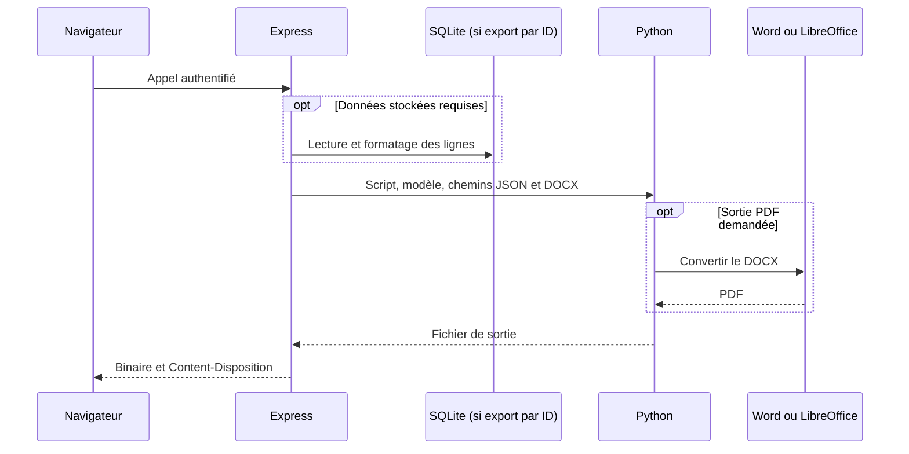

# 04 — Pièces jointes, modèles Word et exports PDF

[Retour au sommaire](../../DOCUMENTATION_TECHNIQUE.md) · [Routes HTTP](03-api-et-donnees.md)

Tradivia manipule deux familles de documents : les **pièces jointes** déposées dans un conteneur et conservées sur disque, et les **exports** calculés à la demande à partir de modèles Word. Une pièce jointe ne passe pas par Python ; un export n'est pas attaché à un conteneur ni conservé automatiquement dans les uploads.

## Pièces jointes de conteneur

1. `handleFileSelect` dans `App.jsx` insère chaque fichier sous la clé `documents` dans un `FormData`. Le navigateur ajoute lui-même la délimitation multipart ; `authFetch` ajoute le Bearer.
2. La route `POST /api/containers/:id/documents` vérifie la forme de l'identifiant et l'existence du conteneur. Multer ouvre le flux de réception et écrit chaque fichier dans `<UPLOAD_DIR>/containers/<id>/` sous un nom interne combinant un timestamp, un suffixe aléatoire et l'extension originale.
3. Limites : 10 fichiers par requête, 50 Mio par fichier. Les types déclarés acceptés sont PDF, DOC/DOCX, XLS/XLSX, JPEG/PNG/GIF, texte brut et ZIP. Le filtre utilise le MIME fourni au serveur ; ce n'est pas une analyse du contenu ou un antivirus.
4. Après écriture, Express insère `container_id`, nom original, nom interne, MIME et taille en base. Le frontend ajoute les nouvelles métadonnées à la fiche courante. L'API n'expose pas `uploads/` comme dossier HTTP statique.
5. Les routes `download` et `view` vérifient le couple `(id du document, id du conteneur)` et l'existence du fichier. Elles renvoient le même contenu et changent la disposition `attachment`/`inline`. Le frontend demande un `Blob` avec authentification. L'aperçu tente d'ouvrir une URL temporaire dans un nouvel onglet ; son affichage dépend des formats reconnus par le navigateur.
6. La suppression d'un document retire son fichier s'il existe, puis la ligne SQLite. La suppression du conteneur retire tout son répertoire de documents ainsi que les métadonnées. Ces opérations ne sont pas une transaction unique entre système de fichiers et SQLite ; après une panne, des métadonnées et des fichiers peuvent ne plus correspondre.

## Quatre modèles canoniques et leurs balises

Dans [`workers/documents/templates/`](../../workers/documents/templates/), les modèles `.docx` sont des archives Office Open XML. Le texte fixe, les en-têtes, styles et tableaux sont définis par les modèles. Les balises `{{ cle }}` sont des champs texte, pas un langage de calcul. Les champs ci-dessous ont été relevés dans les modèles présents.

| Modèle | Balises |
| --- | --- |
| `template_Tradivia_ajust.docx` | `client_nom`, `client_identity`, `client_adresse`, `numero`, `lieu`, `date`, `qte_kg`, `designation`, `pu_ttc`, `pt_ttc`, `ajustement_arrondi`, `total_ttc`, `montant_ht`, `tva`, `pt_ttc_letters`, `mode_paiement`. |
| `template_tradivia.docx` | `client.name`, `client.ice`, `numero`, `lieu`, `date`, `qte_kg`, `designation`, `pu_ttc`, `pt_ttc`, `montant_ht`, `tva`, `pt_ttc_letters`. |
| `template_ordre_virement_TVA.docx` | `date`, `montant`. |
| `template_Ordre_de_virement_zizi.docx` | `date`, `nom`, `RIB` (majuscules), `montant`, `montant_lettres`. |

Au chargement, l'API choisit le modèle de facture ajusté si son fichier existe, sinon le modèle historique. Les modèles des ordres sont configurés séparément avec leur casse exacte. Note, référence et banque ne figurent pas parmi les balises des ordres. Les mentions de société déjà inscrites dans le modèle sont statiques : l'écran Société ne déplace ni ne modifie du texte dans Word.

### Les trois parcours d'export de facture

| Parcours | Base des données | API / résultat |
| --- | --- | --- |
| Boutons unitaires de l'écran Factures | `buildInvoiceVars` dans React formate la facture déjà chargée et sa fiche client. Il convertit le total en lettres après arrondi au dirham. | `POST /api/invoice` (PDF) ou `/api/invoice/docx` ; variables fournies par le navigateur, sans relecture de la ligne stockée par cette route. |
| Téléchargement par ID, utilisé par l'assistant | Lecture SQLite de la facture et du client, `buildInvoiceVarsSrv` ; convertit aussi les centimes et fournit des alias `client.*`. | `GET /api/factures/:id/export?format=pdf` ou `docx` ; le document est produit au clic. |
| Groupe sélectionné ou filtré | IDs envoyés par React ; relecture de toutes les lignes par l'API, ordre croissant date/ID, préparation via le formateur serveur. | `POST /api/factures/export-group` ; un seul document fusionné par demande. |

Conséquence : un export unitaire de l'écran et un export serveur par ID peuvent avoir une formulation différente du montant en lettres. Le formateur de l'écran ne fournit pas non plus `client.name`/`client.ice` au modèle de secours : si le modèle principal est absent au démarrage, le remplacement par le modèle historique est compatible avec les exports construits par le serveur, mais peut faire échouer l'export unitaire de l'écran. Les routes d'ordres lisent elles-mêmes leurs lignes ; la conversion en lettres de l'ordre bénéficiaire est côté serveur.

## Orchestration côté Node : de l'appel au téléchargement



- `getPython` privilégie `PYTHON_EXECUTABLE`, puis vérifie les chemins locaux Windows `.python/python.exe`, `.venv/Scripts/python.exe`, `py -3`, enfin `python3` et `python`. Un candidat est testé avec `import docx` ; le choix réussi est mémorisé dans le processus.
- `runFill` crée un répertoire temporaire `tradivia-*`, écrit `vars.json` et exécute `fill_template.py` avec `execFileSync` (délai de 30 s). Pour un lot, `runMergeFill` utilise `tradivia-merge-*`, `vars_list.json`, `merge_invoices.py`, une option `--fill-script` et un délai de 120 s. `--pdf <fichier>` est ajouté seulement si demandé.
- La route lit le fichier créé, renseigne `Content-Type` et `Content-Disposition`, renvoie le binaire, puis efface le dossier temporaire ; les helpers suppriment aussi leur dossier en cas d'échec du sous-processus. Les noms de sortie de certaines routes sont assainis avec `safeDownloadName` ; le navigateur peut choisir un autre nom, notamment `factures_filtrees.*` ou `factures_selectionnees.*`.
- `sendDocumentError` journalise l'erreur et distingue, si possible, Python introuvable, Word indisponible dans la session, convertisseur/modèle manquant ou délai dépassé. Le traitement synchrone immobilise la boucle d'événements de l'API pendant la génération ; l'export groupé n'est pas un job en arrière-plan.

## `fill_template.py` : remplissage et conversion

| Fonction | Traitement |
| --- | --- |
| `_resolve` | Suit chaque segment d'une clé à points dans les dictionnaires ; `None` devient chaîne vide, clé absente signalée. |
| `_iter_paragraphs` | Parcourt les paragraphes d'un élément Word et les tableaux imbriqués ; évite de reparcourir une même cellule fusionnée dans un tableau. |
| `_replace_in_paragraph` | Concatène le texte des *runs* (fragments de mise en forme Word), repère les balises et remplace de droite à gauche pour préserver les positions des balises précédentes. Retouche les runs nécessaires au lieu de remplacer tout le paragraphe ; une balise fractionnée entre plusieurs runs fonctionne. |
| `fill` | Ouvre le modèle, parcourt le corps et les en-têtes/pieds de page standard, première page et pages paires. Vérifie les balises restantes dans les paragraphes parcourus ; une variable manquante fait échouer la sortie au lieu de livrer un document incomplet. Sauvegarde le DOCX et renvoie le nombre de substitutions. |
| `to_pdf_windows` | `pythoncom` et `win32com.client` pilotent Microsoft Word en COM. Ouvre en lecture seule, utilise `ExportAsFixedFormat` pour un PDF et referme Word en `finally`. Nécessite Word et une session Windows capable de lancer COM. |
| `find_soffice` et `to_pdf_libreoffice` | Recherche `soffice`/`libreoffice` dans le PATH ou les chemins Windows usuels. Lance LibreOffice sans interface, convertit et renomme la sortie au besoin. Délai interne 60 s, toujours soumis au délai de l'appel Node. |
| `to_pdf` | Essaie Word sous Windows, puis LibreOffice si aucune sortie ne paraît ; hors Windows, passe à LibreOffice. Contrôle que le fichier sortant commence par `%PDF-`. |
| `main` | Arguments `template.docx output.docx variables.json [--pdf output.pdf]`, lecture JSON UTF-8, appel `fill` puis conversion facultative. |

## `merge_invoices.py` : un document pour plusieurs factures

- `merge` refuse une liste vide. Pour chaque jeu de variables, il crée un JSON et un DOCX temporaires et lance le remplisseur avec le même interpréteur (`sys.executable`).
- Le premier DOCX est la base. Le code détache temporairement sa section finale, copie en profondeur les éléments du corps des factures suivantes, ignore les descriptions de section finales et supprime les ruptures de section rencontrées dans les paragraphes copiés.
- `_start_on_new_page` ajoute `w:pageBreakBefore` au premier paragraphe copié de chaque facture suivante ; la première facture ne reçoit pas de saut supplémentaire. Le script replace la section finale du premier document puis sauvegarde. Ce mécanisme concatène les corps d'un **même** modèle ; il n'effectue pas une fusion générale des relations et ressources de documents Word indépendants.
- Le `finally` supprime les fichiers temporaires enregistrés ; un échec pendant la création d'un élément, avant son enregistrement dans la liste de nettoyage, peut laisser sa paire temporaire. `main` peut ensuite convertir le résultat une seule fois en PDF.

Commandes du worker, à partir d'un jeu de variables de test qui couvre les balises du modèle :

```text
python workers/documents/fill_template.py MODELE.docx SORTIE.docx VARIABLES.json [--pdf SORTIE.pdf]
python workers/documents/merge_invoices.py MODELE.docx LISTE_DE_VARIABLES.json SORTIE.docx [--pdf SORTIE.pdf]
```

Le module [`test_documents.py`](../../workers/documents/test_documents.py) exerce le remplissage des modèles livrés, un remplacement réparti sur plusieurs runs, le rejet d'une variable absente et une fusion de deux factures. L'intégration HTTP contrôle les flux réels DOCX quand `TEST_DOCUMENT_EXPORTS=1`. Voir les [vérifications](06-exploitation.md#verification-effectuee).
